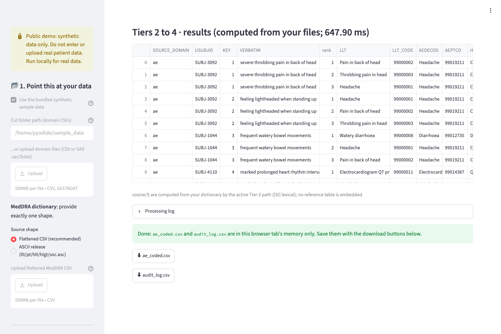
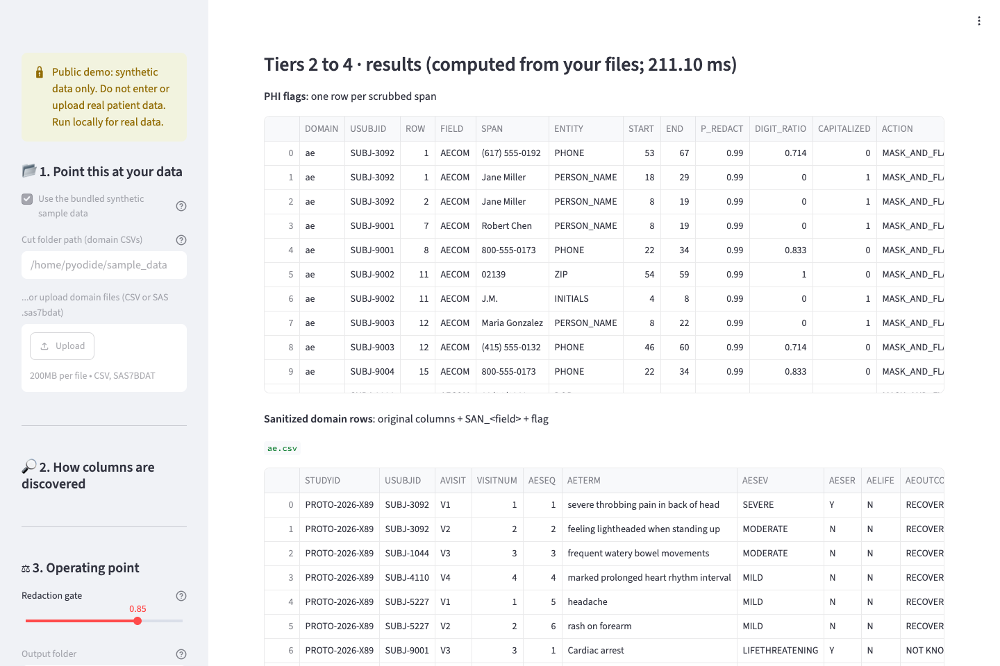
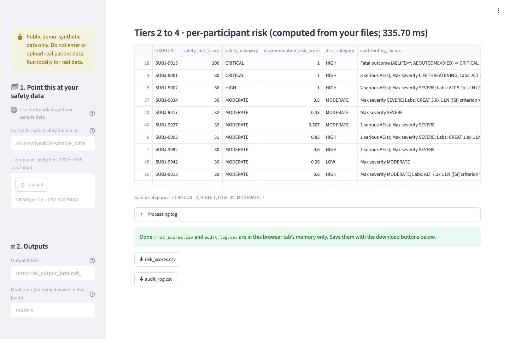
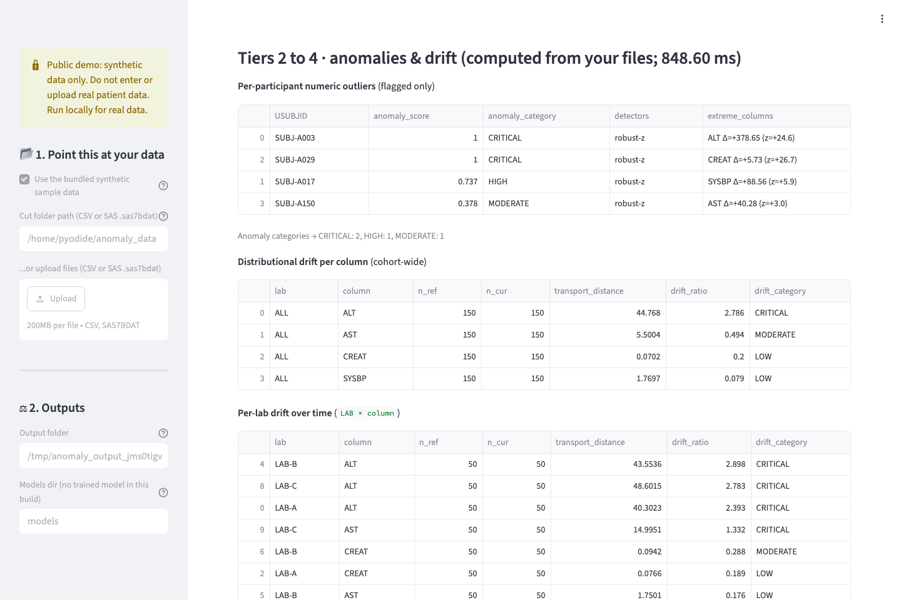

# eCRF pipeline apps: Coding QC assist, De-identification review assist, Participant risk screening, Central statistical monitoring

[](https://github.com/patrickiben/ecrf-pipeline-apps/actions/workflows/qc.yml)

**New here?** Start with the [User Guide](USER_GUIDE.md) for step-by-step use of all four apps, or read the
[evaluation case study](https://patrickiben.github.io/ecrf-pipeline-apps/evaluation.html) and the [case study](https://patrickiben.github.io/ecrf-pipeline-apps/case-study.html)
([`docs/evaluation.html`](docs/evaluation.html), [`docs/case-study.html`](docs/case-study.html)).

Four independent Streamlit programs that run on your own machine, with no network calls, and read the
**same cut folder** without interfering (Central statistical monitoring reads its own longitudinal demo). They
also [run in your browser](#run-in-your-browser-no-install) on the bundled synthetic data, with nothing to
install. Everything bundled is **synthetic**; none of the apps is a validated system.

| App | Reads | Needs | Writes |
|---|---|---|---|
| **Coding QC assist** ([`meddra_app.py`](meddra_app.py)) | the one verbatim column you select (`AETERM` or a synonym) | domain CSVs **plus** a MedDRA dictionary (flattened CSV or `.asc` release) | `ae_coded.csv`, `audit_log.csv` |
| **De-identification review assist** ([`phi_app.py`](phi_app.py)) | **every non-numeric column** (found by content; confirmed in pre-flight) | domain CSVs only, **no dictionary**; ignores any `meddra*.csv` | `phi_flags.csv`, `sanitized/<domain>.csv`, `audit_log.csv` |
| **Participant risk screening** ([`risk_app.py`](risk_app.py)) | safety domains (`ae`/`lb`/`eg`/`vs`/`pe`) classified by content | those CSVs only, **no dictionary and no SAP file**; scores against built-in `[SI]` criteria | `risk_scores.csv`, `audit_log.csv` |
| **Central statistical monitoring** ([`anomaly_app.py`](anomaly_app.py)) | measurable numeric columns plus optional time/visit, lab/site and free-text columns, aligned by `USUBJID` | longitudinal CSV or SAS files only, **no dictionary**; scores against built-in `[SI]` criteria | `anomalies.csv`, `drift.csv`, `lab_drift.csv`, `lab_compare.csv`, `text_anomalies.csv`, `audit_log.csv` |

Each app writes its own audit log with the files it read, the per-tier path that ran (REAL or the labeled
stand-in `[SI]`) and every effective threshold, so a run is reproducible from its audit alone. The four programs
share no module on purpose; see the header comment in each file before editing.

## Run locally

Quickstart: 60 seconds, sample data included.

**macOS, double-click:** `Launch Coding QC assist.command`, `Launch De-identification review assist.command`,
`Launch Participant risk screening.command` or `Launch Central statistical monitoring.command`. Finder runs these in
Terminal and opens the app in your browser, with no typing needed. The `.bat` files are for Windows; on a Mac use the `.command` files
(double-clicking a plain `.sh` may open it in an editor instead of running it).

From a terminal instead:

```bash
# macOS / Linux
./run_meddra.sh        # Coding QC assist                 -> http://localhost:8501
./run_phi.sh           # De-identification review assist  -> http://localhost:8502
./run_risk.sh          # Participant risk screening       -> http://localhost:8503
./run_anomaly.sh       # Central statistical monitoring   -> http://localhost:8504

# Windows
run_meddra.bat
run_phi.bat
run_risk.bat
run_anomaly.bat
```

The scripts create a `.venv` on first run and install the dependencies themselves. Then, in each app's sidebar,
set **Cut folder path** to [`sample_data/`](sample_data/), the one synthetic cut the coding, de-identification
and risk apps read (the worked examples in the [case study](https://patrickiben.github.io/ecrf-pipeline-apps/case-study.html) plus a larger set of
participants), or to [`anomaly_data/`](anomaly_data/) for Central statistical monitoring. Confirm the pre-flight
panel, then click **Execute**. Each folder's README says exactly what a run should show.

All apps accept **CSV or SAS `.sas7bdat`** (SDTM/ADaM dumps). CSV works out of the box; to load `.sas7bdat`,
install `pyreadstat` (`pip install pyreadstat`). The monitoring app's real detectors are opt-in: `POT` with
`scipy` turns drift into **real Sinkhorn optimal transport**, and `scikit-learn` adds a real **Isolation Forest**
numeric-outlier corroborator; without them it runs labeled `[SI]` stand-ins with identical output columns.

Manual equivalent: `pip install -r requirements.txt && streamlit run <app>.py`.

## Run in your browser (no install)

- [Coding QC assist](https://patrickiben.github.io/ecrf-pipeline-apps/app/meddra.html) (`meddra_app.py`)
- [De-identification review assist](https://patrickiben.github.io/ecrf-pipeline-apps/app/phi.html) (`phi_app.py`)
- [Participant risk screening](https://patrickiben.github.io/ecrf-pipeline-apps/app/risk.html) (`risk_app.py`)
- [Central statistical monitoring](https://patrickiben.github.io/ecrf-pipeline-apps/app/anomaly.html) (`anomaly_app.py`)

Each page runs the same Python program inside your browser tab with [stlite](https://github.com/whitphx/stlite),
which is Streamlit on Pyodide (CPython compiled to WebAssembly), so there is no server to sleep, wake or sign in
to. The page downloads Python and the app's packages from a CDN, fetches the program and its synthetic data from
GitHub Pages, and runs everything on your device.

Each page opens on the bundled synthetic cut; click **Execute**. The first visit downloads about 30 MB and was
measured at about 5 seconds to a usable app on a fast connection and about 30 seconds at 10 Mbps; later visits
load from the browser cache. The pages need WebAssembly and module workers (current Chrome, Edge, Firefox or
Safari); they were tested in Chrome only. Landing page: https://patrickiben.github.io/ecrf-pipeline-apps/

**Privacy:** Runs in your browser; files are processed on your device and not uploaded by the app; the page is
downloaded from GitHub Pages and the CDN, which see your IP address; synthetic data only; not a validated or Part
11 system.

The pages run each app in **hosted mode** (`ECRF_HOSTED=1`): every data input (the uploaders, folder paths and
models dir) is locked to the bundled synthetic cut, outputs go to a folder in the tab's memory (save them with the
download buttons), a banner says the demo takes synthetic data only, and the audit records `hosted_mode=true`.
Only the labeled `[SI]` stand-in path runs in the browser, and the pages load numpy and pandas only. The real
model path cannot run there as built: the coding and de-identification apps load Needle3's native engine library
(`libneedle`) from the models dir, Laya needs torch, hnswlib has no Pyodide build, and Pyodide's xgboost (2.1.4) is
older than the 3.4.1 used to train the models. Everything bundled is synthetic: no real patients, no real study and
no licensed dictionary. The demo dictionary's codes are 99-prefixed placeholders, not MedDRA codes. Hosted mode is
off unless a deployment switches it on, so a local run behaves exactly as described in the rest of this README;
there, opening the app with `?demo=1` appended simply starts with **Use the bundled synthetic sample data**
checked. Use a local run for real data.

### How the browser build is put together

`docs/app/` holds what GitHub Pages serves for the four apps:

- `meddra.html`, `phi.html`, `risk.html`, `anomaly.html`: one page per app, rendered from
  `tools/browser_app_template.html`. Each shows a loading notice, its measured limits and a screenshot of the
  app's results until Python is ready, and keeps the screenshot with a short explanation if the app cannot start.
  If stlite's stylesheet does not load (the app then runs unstyled), the page fetches it again, twice at most and
  after a pause, and if that fails shows a notice with a Reload button above the app.
- `launch.js` and `app.css`: the shared loader and page style.
- Byte-identical copies of the four `.py` files and of every CSV in `sample_data/` and `anomaly_data/`, which the
  pages load from Pages.
- `wheels/`: three small pure-Python wheels the Streamlit build needs that Pyodide does not ship (`itsdangerous`
  2.2.0, BSD-3-Clause; `python-multipart` 0.0.32, Apache-2.0; `toml` 0.10.2, MIT), pinned by sha256 and served from
  Pages so a visit never contacts PyPI. Each wheel carries its license text in its `.dist-info` folder.

After editing an app or its sample data, run `python tools/sync_browser_apps.py` and commit what it changes. CI
fails while `docs/app/` is out of step (the `browser-build` job, and QC check D4). The pages pin stlite 1.12.0
(Streamlit 1.65.0 on Pyodide 314.0.3, Python 3.14) by exact version, check its stylesheet and core modules with
Subresource Integrity, and carry a Content-Security-Policy that lets them connect only to GitHub Pages and
cdn.jsdelivr.net. To move to a newer stlite, change the pins at the top of `tools/sync_browser_apps.py`, run it
with `--verify-cdn`, re-render, and test the four pages in a browser before merging. One harmless quirk: each
download button logs a console error when it appears (stlite probes a placeholder URL that the page's policy
blocks); the file still downloads.

### Serving the apps from your own server

The apps also support a public server deployment that you run yourself. Set the environment variable
`ECRF_HOSTED=1` (or the Streamlit secret `hosted = true`) and start Streamlit with `--server.maxUploadSize 1` (or
`STREAMLIT_SERVER_MAX_UPLOAD_SIZE=1`), keeping the cap out of `.streamlit/config.toml`, which local runs share. In
hosted mode the apps never read or process an uploaded file, but Streamlit's upload endpoint still keeps the bytes
a crafted client sends, even to a disabled uploader, in server memory until the session expires; the 1 MB cap
bounds that. Do not put an `ECRF_HOSTED` key in the secrets: Streamlit copies top-level secrets into the
environment over the host's own value, so the apps treat that key as on whatever it says. The switch fails closed:
any value other than empty, `0`, `false`, `no` or `off` turns hosted mode on, and so does a secrets file that
exists but does not parse (for example `hosted = True` with a capital T), because Streamlit only logs that error on
the server. Before you share the link, open the app and confirm that the "Public demo: synthetic data only" banner
shows on the main page and at the top of the sidebar and that the uploaders and folder fields are grayed out; if
the banner is missing, hosted mode is off.

## Screenshots

Captured from the in-browser pages (hosted mode, bundled synthetic data) after **Execute**; a local run on the
stand-in path shows the same tables.



*Coding QC assist: top three candidates per verbatim, with placeholder codes; the ranking comes from the `[SI]`
lexical stand-in.*



*De-identification review assist: one row per scrubbed span; every name and number shown is invented.*



*Participant risk screening: per-participant safety and discontinuation scores, sorted highest risk first, with
the reasons for each.*



*Central statistical monitoring: flagged numeric outliers, cohort-wide drift per column and per-lab drift on the
longitudinal demo.*

## Landing page, evaluation and case study

GitHub Pages publishes `docs/` from `main` (Settings > Pages) at https://patrickiben.github.io/ecrf-pipeline-apps/:

- [`docs/index.html`](docs/index.html): the landing page, with the four apps, links to the in-browser pages in
  [`docs/app/`](docs/app/) and the screenshots.
- [`docs/evaluation.html`](docs/evaluation.html): the evaluation case study. What was measured on the coding and
  de-identification real model path and its stand-in, on what synthetic data, with grouped splits and calibration,
  and the failures stated plainly. The long-form source is [`docs/EVALUATION.md`](docs/EVALUATION.md); the Stage 0
  feasibility record is [`docs/FEASIBILITY.md`](docs/FEASIBILITY.md).
- [`docs/case-study.html`](docs/case-study.html): the four-tier design and two worked examples, with every number
  tagged by the path that produced it and where it was recorded. It replaces the two earlier decks; their old URLs
  (`docs/deck_a_four_tier_pipeline.html`, `docs/deck_b_implementation_walkthrough.html`) are redirect stubs.

All three are single static files with inline CSS and no external scripts, stylesheets, fonts or images (QC check
D2), and every local link in them must resolve (D3).

## Using your own cut

1. Put the domain files (CSV or SAS `.sas7bdat`) in one folder, or upload them directly in the sidebar; no code
   edits either way.
2. **Coding QC assist:** provide exactly one dictionary shape: a flattened CSV with an LLT-name and a PT-name
   column (recommended), or a folder of licensed `llt.asc` / `pt.asc` / `hlt.asc` / `hlgt.asc` / `soc.asc`. A
   `meddra*.csv` inside the cut folder is found automatically. Confirm which verbatim column will be read in the
   pre-flight panel; if your header spells it differently, add it to `AETERM_SYNONYMS` at the top of
   `meddra_app.py`.
3. **De-identification review assist:** every column that is not strictly numeric is scanned by default; in the
   pre-flight multiselect, deselect any known-safe structured column (a date or coded field you do not want
   touched). No rule editing is needed.
4. **Participant risk screening:** point at a folder with your safety domains (`ae`/`lb`/`eg`/`vs`/`pe`). Each
   file is classified by its *content* (signature columns), not its name, so oddly named dumps work. No SAP or
   protocol file is needed: the app scores raw data against clearly labeled built-in criteria tagged `[SI]` and
   records that source in the audit.
5. **Central statistical monitoring:** point at a folder of longitudinal files (one row per participant per
   visit) with a participant ID column (`USUBJID`) and one or more numeric columns to measure. Optional signals are
   detected by content or synonym and shown in pre-flight: a time/visit column (for example `VISITNUM` or
   `AVISITD`) enables drift, a categorical lab/site column (for example `LAB`) enables per-lab drift and the
   between-lab comparison, and any long free-text column (for example `LABCOM` or `AECOM`) is scanned for text
   outliers. Only flagged observations are written.
6. Set the operating point where one exists (coding gate default 0.88; redaction gate default 0.85). Whatever you
   end at is written to the audit with the run.

## Stand-in vs real components

Without the trained weights installed, Tiers 2 to 4 run as **labeled deterministic stand-ins** (`[SI]` in the
banner and the audit): lexical retrieval for coding, guarded regular expressions for identifier spans, rule-based
probabilities, a transparent weighted rule engine for risk screening, and, in the monitoring app, a robust-z
numeric gate, a labeled 1-D Wasserstein drift stand-in and a bag-of-words text-isolation stand-in. The
de-identification stand-in reproduces its worked trace exactly. The coding stand-in is lexical, so verbatims that
differ in wording from every dictionary term go to a human coder rather than being auto-coded. The monitoring
app's drift becomes **real Sinkhorn optimal transport** (`ot.sinkhorn2`) with `POT` and `scipy`, and its
numeric-outlier corroborator becomes a real **Isolation Forest** with `scikit-learn`; its text detector has no real
model path and stays a labeled stand-in.

**The real model path (coding and de-identification).** With the open-source runtimes installed (Cactus Needle3,
hnswlib, Laya, XGBoost) and a **models dir** holding their weights and the trained gates, these two apps run their
real Tiers 2 to 4 with no network access. [`eval/README.md`](eval/README.md) says how to install the pinned
runtimes and build the models dir (`python eval/fetch_models.py --out models`), and the
[evaluation case study](https://patrickiben.github.io/ecrf-pipeline-apps/evaluation.html) has what was measured, on synthetic data only: the real coding path
put the right preferred term at rank 1 for 78% of held-out verbatims against 54% for the stand-in and auto-coded
38% with no error, and the real de-identification path left 91 of 308 held-out identifiers readable against 108
for the stand-in. A tier shows REAL only when its artifact loads; an artifact that is present but cannot be loaded,
or a trained gate whose inputs are missing, **stops** the run rather than silently substituting a stand-in. The
risk and monitoring apps have no trained-model path: a model file in their models dir stops the run.

## What this build does NOT do

No scanned-document or bounding-box path (the input is tabular eCRF data), no negation feature, no clinical
variable derivation, and nothing leaves the machine (in the browser build, nothing you load is uploaded by the
app). No review, override or sign-off step and no reviewer identity: the apps propose, and review happens on the
exported files. Not a validated system, and not built to 21 CFR Part 11 (no access control, electronic signatures
or protected audit trail; the audit log is a plain CSV). The de-identification outputs still contain the
identifiers (`phi_flags.csv` holds each span's text, and the sanitized files keep the original column), so treat
them as PHI; the output supports a review and certifies nothing, which remains an organizational determination.
**Participant risk screening is decision support:** it ranks and flags participants for human review but does
NOT make a clinical determination, its scores are capped rule sums rather than probabilities, and it scores raw
data against built-in `[SI]` criteria rather than parsing a protocol or SAP. See the
[case study](https://patrickiben.github.io/ecrf-pipeline-apps/case-study.html) for the full limits.

## Files

```
meddra_app.py            Coding QC assist                (self-contained; do not share modules with the others)
phi_app.py               De-identification review assist (self-contained; same rule)
risk_app.py              Participant risk screening      (self-contained; same rule)
anomaly_app.py           Central statistical monitoring  (self-contained; same rule)
requirements.txt         stand-in-path dependencies (+ optional pyreadstat / POT+scipy / scikit-learn blocks)
run_meddra.sh / .bat     one-command launchers (create .venv on first run, opt out of the telemetry prompt)
run_phi.sh    / .bat     the same, De-identification review assist on port 8502
run_risk.sh   / .bat     the same, Participant risk screening on port 8503
run_anomaly.sh/ .bat     the same, Central statistical monitoring on port 8504
Launch *.command         macOS double-click launchers; Finder runs them in Terminal
.streamlit/config.toml   disables Streamlit usage stats, so nothing leaves the machine
.github/workflows/qc.yml CI: runs tests/qc_test.py and tests/test_sibling.py on every push and pull request in
                         three variants (stand-in and optional-extras on Python 3.12; browser-stack on Python 3.14.0
                         with the Streamlit, pandas, numpy and pyarrow versions the in-browser pages run), and checks
                         docs/app/ against the apps (tools/sync_browser_apps.py --check)
sample_data/             the one SYNTHETIC cut the coding, de-identification and risk apps read (+ generate.py)
anomaly_data/            the monitoring app's own SYNTHETIC longitudinal demo (labs.csv + generate.py)
eval/                    the real model path: setup, synthetic evaluation data, training and evaluation scripts, results;
                         and the within-sibling check of the coding assist (registered plan, scripts, results)
docs/                    GitHub Pages: index.html, evaluation.html, case-study.html, two redirect stubs for the
                         retired decks, EVALUATION.md, FEASIBILITY.md, screenshots (img/), .nojekyll
docs/app/                the in-browser build: four pages, launch.js, app.css, copies of the apps and data, pinned wheels
tools/                   sync_browser_apps.py (keeps docs/app/ in step; --check for CI) and the page template
USER_GUIDE.md            step-by-step instruction manual for running all four apps
tests/qc_test.py         portable end-to-end test harness (`python tests/qc_test.py` reports passed, failed and
                         skipped checks for the installed dependencies)
tests/test_sibling.py    checks for the within-sibling evaluation (plan guard, exact tails, known answers, a rerun)
QC_REPORT.md             current QC status first, then what was tested, the bugs found and fixed, and how to re-run
```
